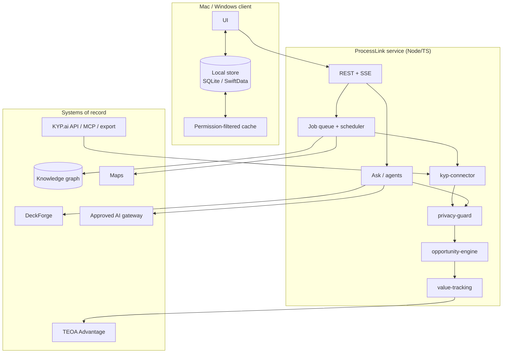

# Architecture

ProcessLink is the value layer between KYP.ai and the Flightdeck system. It
consumes discovery, and produces prioritised, owned, evidence-backed
improvement work in TEOA, the knowledge graph, Maps and DeckForge.

## 1. One product, three forms

```
ProcessLink/
  macos/ProcessLink/        native SwiftUI + SwiftData (primary form)
  web/                      React + Vite (Flightdeck sub-app replacement)
  windows/                  Tauri 2 shell around the same web build
  packages/                 shared TypeScript domain (mirrors the Swift kit)
  docs/                     Phase 0, architecture, ontology, risks
```

| Form | Runtime | Store | Offline | Status |
|---|---|---|---|---|
| macOS | Swift 6.2, SwiftUI, SwiftData, macOS 26+ | `~/Library/Application Support/ProcessLink` | Full read + drafts | Built, tested, snapshotted |
| Web | React 19 + Vite, strict TS | API / IndexedDB cache | Read cache | Built, `vite build` verified |
| Windows | Tauri 2 (WebView2) + Rust | SQLite via the shared schema | Read cache + queued writes | Scaffolded; not built on a Windows host |

The domain rules are duplicated **by hand** between `ProcessLinkKit` (Swift)
and `packages/domain` (TypeScript), with a shared golden-fixture file that
both test-suites read. This is deliberate: a code-generated bridge would hide
the privacy rules behind a tool that nobody reviews. The fixture is the
contract.

## 2. What is shared with DeckForge and DiagramForge

| Shared concern | How ProcessLink uses it |
|---|---|
| Design language | System controls, one accent, SF Symbols, no custom chrome. The web uses the same token names as DiagramForge (`space`, `radius`, `accent`). |
| `diagram-schema` | ProcessLink emits `signavio-map/1` compatible nodes/edges plus a `kgNodeId` extension; it does not fork the canvas model. |
| `diagram-engine` | Generation is server-side: KYP steps → lanes → nodes → edges. The renderer stays DiagramForge's. |
| `deck-schema` | Review briefs map to DeckForge's slide contract; the app exports Markdown today, DeckForge consumes the same sections tomorrow. |
| `ai-core` | One `LLMProvider` contract: local (on-device) or hosted gateway. Same classification gate, cost meter, structured outputs, injection defences. |
| `ingest` | Job queue shape reused: checkpoint, retry, dead-letter, audit. |
| `flightdeck-sdk` / auth | Mini App: SSO session, workspace id, role claims, node ACL inherited. |
| `collab` | Map edits and A3 edits are proposals with presence; not wired in this prototype. |

**Reuse rule:** no sub-app imports another sub-app's internals. ProcessLink
talks to Maps and TEOA through their contribution/read contracts, exactly as
`advantage/mapsRead.ts` does today.

## 3. Runtime



### 3.1 Sync pipeline

1. **Discover** — list changed objects since the checkpoint (updated-at
   cursor; webhook event where supported).
2. **Fetch** — paginated, rate-limited, retried with jitter; `Retry-After`
   respected; a 429 does not advance the checkpoint.
3. **Minimise** — keep aggregates; drop any object with a person id and count
   the drop; reject raw capture types.
4. **Classify** — read the data-classification label; `restricted` stops the
   record here.
5. **Validate** — schema version, required fields, plausible ranges.
6. **Resolve** — match to KG entities; low confidence goes to the review queue.
7. **Stage** — write a batch with a content hash.
8. **Commit** — idempotent upsert into the local store, then propose KG nodes.
9. **Audit** — one immutable event per step, counts only.

### 3.2 In-house discovery

`kyp-connector` is no longer the only source. `process-model` now has an
in-house path: `EventLogImporter` (CSV → hashed cases, role resources, masked
activity text) feeds `ProcessMining` (directly-follows graph, variants,
cycle/wait, rework, handoffs, conformance). The result is written as the same
`ProcessRecord` / `StepRecord` / `VariantRecord`, with
`source = "In-house process mining"`, so KG, Maps, opportunities and Ask need
no branch. Local task capture records only frontmost app name, minutes and
switches — no titles, keys or screenshots — and turns a session into a
process whose waste is context switching. KYP remains an optional source for
enterprise breadth, not a hard dependency.

### 3.3 Maps: the document is the contract

ProcessLink does not own a private map format. It reads and writes
`signavio-map/1` documents through the Flightdeck Maps API, adding two
optional fields: `node.data.processLink` (binding + metrics snapshot) and
`meta.processLink` (process, generation, source). Flightdeck's own shape
inspector renders a read-only ProcessLink panel from the node snapshot, so the
mined step, opportunity and saving are visible inside the map. Map edits are
read back by ProcessLink, compared with the mined step, and recorded as drift
plus an audited proposal; they never overwrite discovery. The full contract is
in [`MAPS-INTEGRATION.md`](MAPS-INTEGRATION.md).

### 3.4 Meetings and graph write-through

A meeting is a **page of typed blocks**, not a free-text note:

| Block | What it creates |
|---|---|
| Heading, text, bullet, to-do, callout | Reading structure only |
| Decision | A `Decision` KG node, `documented_in` the meeting |
| Action | An `Action` KG node, `documented_in` the meeting, `assigned_to` the owner role |
| Link | A reference to a process, opportunity or initiative |

The meeting itself is a `Meeting` node. Linking a process adds
`process —discussed_in→ meeting`; linking an initiative adds
`initiative —discussed_in→ meeting`. Promoting an action runs the same
initiative gate as an opportunity: named owner, stage, saving, audit; it never
deploys anything. Edits to a decision/action refresh its node; a merge closes
the losing node, re-points its edges in one transaction and never leaves a
self-loop.

This is why there is no separate "notes database": the page, the decision, the
action and the improvement work are the same graph, read at different
granularity.

### 3.5 Write paths that need a human

| Write | Gate |
|---|---|
| KG ontology change | Admin approval; migration is versioned and reversible. |
| Entity merge below 0.85 | Review queue; never silent. |
| Savings validation | Named validator + before/after evidence; must be committed first. |
| Standard-work change | Process owner approves the new SOP version. |
| Automation/agent deployment | Change package approved by owner, CI and security. ProcessLink never deploys. |

## 4. AI layer

- **Provider abstraction.** `LLMProvider` with `complete`, `stream`,
  `structured`, `embed`. Implementations: local (Transformers.js / on-device
  model) and the hosted gateway (Claude by default, region-pinned,
  classification-gated).
- **Context assembly.** Retrieve KG nodes by graph traversal + vector
  similarity, hydrate KYP aggregates, cap by token budget, attach a citation
  for every fact.
- **Untrusted input.** Every KYP text, SOP and import is delimited and
  labelled data; instructions inside are never executed.
- **Grounding.** The answer contract requires `citations[]`; a figure without
  a citation fails the response validator. Unknowns become `toVerify[]`.
- **Evaluation.** 12 golden questions in this build; rubric checks
  correctness, citation accuracy and usefulness; runs on every prompt/model
  change.

In the prototype, `AskEngine` (Swift and TS) is the local provider: a
deterministic engine that answers from read models and always cites. It is
intentionally not a language model, so the citation discipline can be tested
without a network.

## 5. Security and privacy enforcement points

| Boundary | Control |
|---|---|
| Connector credentials | Flightdeck secret store; read-only scope; `YOUR_API_KEY_HERE` placeholders only. |
| Classification | Checked before store, export, KG write and AI call. |
| Group size | Checked before display, export, KG write and AI call. |
| PII | Scanned before any hosted call; mask or block. |
| Prompt injection | Data delimiters + instruction hierarchy + tool allowlist. |
| Audit | Append-only local log; sync, query, AI, approval, export. |
| Secrets | No key in prefs; no key in the repo; secrets scan in CI. |
| Supply chain | SBOM, licence scan (GPL/AGPL flagged), pinned deps. |

## 6. Performance targets

| Path | Target | Approach |
|---|---|---|
| Common KG view | < 2 s | Pre-materialised read models; indexed node ids; cached aggregates. |
| 500-node map generation | < 5 s worker | Column layout in one pass, no per-node queries, snapshot cache keyed by content hash. |
| First AI token | < 2 s | Context pre-assembled; streaming; local provider for quick asks. |
| Sync backfill | Defined window | Cursor + parallel pages, bounded concurrency, resumable. |
| Offline launch | Instant | Local store is the read model; sync is incremental. |

## 7. Observability

Structured logs carry ids and counts, never process content: `sync.run`,
`sync.batch`, `kg.proposal`, `ask.query`, `ai.call`, `guard.refusal`,
`approval`. The audit log is the user-facing projection of the same events.

## 8. Flightdeck integration

- **Sub-app replacement.** The web form mounts under
  `/api/apps/processlink` with `id: "processlink"`, `minHostVersion: "5.0.0"`,
  `capabilities: []`, a kill switch `SUBAPP_PROCESSLINK_ENABLED` (off by
  default) and an install row. It replaces the Advantage surface, but keeps
  Advantage's tables readable during migration (`advantage-opportunities/1`
  is a valid source).
- **Mini App.** The same web bundle registers as a Mini App with the SDK;
  SSO session and role claims arrive from the host.
- **Roadmap.** Add `kgNodeId` to `signavio-map/1` node data and an
  `opportunity.kgNodeId` column to Advantage; both are additive.

## 9. What is implemented in this build

| Piece | macOS | Web | Windows |
|---|---|---|---|
| Privacy guard (purpose, classification, group size, PII) | ✅ | ✅ | via web |
| Opportunity scoring + route + method recommendation | ✅ | ✅ | via web |
| Savings ledger (estimate → commit → validate, conflicts) | ✅ | ✅ | via web |
| Discovery → opportunity → initiative → A3 | ✅ | ✅ | via web |
| In-house mining (CSV) + task capture | ✅ | sample view | via web |
| Flightdeck `signavio-map/1` read/write + drift | ✅ | adapter next | via web |
| Map generation with KG-bound shapes + overlays | ✅ | ✅ | via web |
| Meetings, block pages, decisions and actions | ✅ | ✅ | via web |
| Graph canvas, search, quality filters, backlinks | ✅ | list + backlinks | via web |
| KG explorer + review queue | ✅ | ✅ (read) | via web |
| Ask with citations + to-verify | ✅ | ✅ | via web |
| Audit log | ✅ | ✅ | via web |
| KYP.ai network connector | sandbox fixture | sandbox fixture | sandbox fixture |
| Live KG write | local proposal | local proposal | local proposal |
| DeckForge deck export | Markdown brief | JSON brief | via web |
