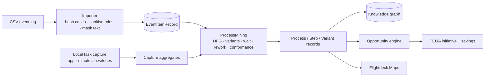

# In-house discovery: replacing the KYP.ai dependency

ProcessLink now has its own discovery path for digital and administrative
work. KYP.ai remains an optional source for enterprise-scale capture; the app
no longer needs it to produce a process, variants, steps, a map or an
opportunity.

## 1. What is implemented

| Capability | KYP.ai equivalent | Here |
|---|---|---|
| Process mining from event logs | Process discovery | CSV import → case/activity/timestamp/resource model → directly-follows graph, variants, cycle time, wait, rework, handoffs, conformance |
| Task mining | Desktop activity capture | Opt-in local sampler: frontmost app name, minutes, switches, idle; aggregated per app |
| Variant analysis | Variant explorer | Case sequences, share, average cycle, rework share |
| Bottleneck analysis | Process insights | Activity wait, rework count, handoff count, automation score |
| Business case / ROI | Opportunity engine | Existing scoring and savings lifecycle, now fed by mined facts |
| Agent/automation handoff | Agent code generation | Existing change-package gate; no autonomous deployment |
| Graph + maps | — | Mined process becomes the same KG nodes, map document and opportunity records |

Deliberately **not** implemented: screenshots, keystroke logging, window
titles, clipboard, OCR of content, or per-person activity. Capturing those
would change the legal basis and the product's purpose. If a future decision
requires them, it is a separate DPIA and works-council process, not a toggle.

## 2. Data path

### Import rules

- `case_id` is SHA-256 hashed; the raw order/ticket id is never stored.
- `resource` is a role. Values that look personal (e-mail, long digits) become
  `role-xxxx`.
- `activity` is masked with the same PII scanner used before AI calls.
- Rows with no case, activity or readable timestamp are skipped and counted.
- All rows stay local. The dataset is `internal` by default; a Restricted
  import is refused by the same guard as everything else.

### Mining output

The `ProcessMining` engine in `ProcessLinkKit` produces:

- activities: event count, case count, average wait, rework count, handoffs,
  resources, automation score + reason;
- edges: directly-follows count and average wait;
- variants: sequence, cases, share, average cycle, rework share;
- process: median/P90 cycle, rework rate, handoff rate, start/end activities;
- conformance: fitness (LCS coverage), exact cases, missing/extra activities.

The same results become `ProcessRecord`, `StepRecord` and `VariantRecord`
with `source = "In-house process mining"`, so Discoveries, Opportunities,
Maps, the KG and Ask work unchanged.

## 3. Local task capture

- Samples the frontmost application every two seconds while the user has
  explicitly started a session.
- Stores **app name, bundle id, minutes, switches, idle minutes** only.
- No window titles, no keystrokes, no clipboard, no screenshots, no person.
- One session is a local aggregate; it is not uploaded.
- "Create process" turns the aggregates into a process whose steps are
  applications and whose waste is context switching.
- Requires no macOS permission: `NSWorkspace.frontmostApplication` and
  `CGEventSource` idle time are unprivileged.

## 4. What is still KYP.ai-shaped

The KYP connector and the `SandboxSync` fixture remain. A connected KYP tenant
still provides broader capture (more applications, server-side aggregation,
enterprise search). The difference is that ProcessLink now has a defensible
**minimum viable discovery** path for a site or a team without waiting for a
KYP licence.

## 5. Limits and open questions

- CSV import maps a fixed header set (`case_id, activity, timestamp, resource,
  application`); a column-mapping UI is the next step.
- Conformance uses reference sequence coverage, not token-based replay; it is
  explainable but less precise than a full conformance checker.
- Task capture observes app switches, not task boundaries. A `task` is inferred
  as a run of events in one app; the user still names the process.
- No cross-person aggregation in this build. Multi-user capture requires the
  group threshold and works-council agreement before it can exist.
- The sample log is synthetic; no customer data is shipped.

## 6. Decision summary

| Question | Answer |
|---|---|
| Can we run discovery without KYP.ai? | Yes, for event logs and app-level task capture. |
| Does it replace KYP entirely? | No. It covers the administrative/digital slice; enterprise capture breadth is still KYP's advantage. |
| Is it private by construction? | The API choice is the boundary: hashes, roles, app names, masks. No content capture exists to disable. |
| Where does it land? | Same KG, same maps, same opportunity pipeline, with `source` distinguishing in-house from KYP. |
