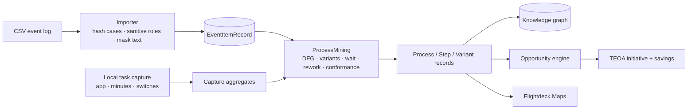

# In-house discovery: replacing the KYP.ai dependency

ProcessLink now has its own discovery path for digital and administrative
work. KYP.ai remains an optional source for enterprise-scale capture; the app
no longer needs it to produce a process, variants, steps, a map or an
opportunity.

## 1. What is implemented

| Capability | KYP.ai equivalent | Here |
|---|---|---|
| Process mining from event logs | Process discovery | Mapped CSV import with extra attributes and cost → directly-follows graph, cases, variants, filters, cycle/wait, rework, handoffs, weekly throughput |
| Task mining | Desktop activity capture | Opt-in local sampler: frontmost app name, minutes, switches, idle; aggregated per app |
| Variant analysis | Variant explorer | Case sequences, share, average cycle, rework share, variant-level conformance |
| Case explorer | Case drill-down | Every hashed case with its timeline, attributes, cost and deltas |
| Conformance | Conformance checking | Reference sequence coverage **and** place-based token replay with missing/remaining tokens |
| Root cause | Process insights | Attribute values correlated with slow cases or rework, with case counts and impact |
| What-if | Simulation | Automate/remove steps, reduce rework/wait; projected median and assumptions |
| Export | — | Cases CSV and a `processlink-mining/1` JSON summary |
| Business case / ROI | Opportunity engine | Existing scoring and savings lifecycle, now fed by mined facts |
| Agent/automation handoff | Agent code generation | Existing change-package gate; no autonomous deployment |
| Graph + maps | — | Mined process becomes the same KG nodes, map document and opportunity records |

Deliberately **not** implemented: screenshots, keystroke logging, window
titles, clipboard, OCR of content, or per-person activity. Capturing those
would change the legal basis and the product's purpose. If a future decision
requires them, it is a separate DPIA and works-council process, not a toggle.

## 2. Data path

### Import and mapping

A CSV is previewed before import. The sheet maps **case id, activity,
timestamp, resource, application** against the real headers; all remaining
columns become filterable attributes (up to 16). A column named `cost` is
parsed as a number.

- `case_id` is SHA-256 hashed; the raw order/ticket id is never stored.
- `resource` is a role. Values that look personal (e-mail, long digits) become
  `role-xxxx`.
- `activity` and every attribute value are masked with the same PII scanner
  used before AI calls.
- Rows with no case, activity or readable timestamp are skipped and counted.
- All rows stay local. The dataset is `internal` by default; a Restricted
  import is refused by the same guard as everything else.
- A cost value is treated as observed cost for that event. If a case-level
  cost is repeated on every row, it will be summed per case; the data-quality
  card shows the observed total so the mistake is visible.

### Mining output

The `ProcessMining` engine in `ProcessLinkKit` produces:

- **cases**: hashed id, ordered events, sequence, start/end, cycle, waiting
  time, rework count, handoffs, resources, attributes, cost;
- **activities**: event count, case count, average wait, rework count,
  handoffs, resources, automation score + reason;
- **edges**: directly-follows count and average wait;
- **variants**: sequence, cases, share, average cycle, rework share;
- **process**: median/P90/mean/max cycle, rework rate, handoff rate,
  start/end activities, total and per-case cost, cases with rework;
- **periods**: up to 12 ISO weeks with cases, median cycle and rework;
- **handovers**: role pair, count and average wait;
- **root causes**: attribute values grouped by slow/rework outcome, with case
  count, average cycle, rework rate and an hours estimate;
- **simulation**: projected median cycle, saved minutes, hours per 1,000 and
  the exact assumptions;
- **conformance**: sequence coverage, exact cases, missing/extra activities,
  plus token replay fitness, missing/remaining/consumed/produced tokens and
  deviating cases.

The workbench presents this in six tabs: **Overview, Process, Cases,
Conformance, Insights, Simulate**. Filters (activity, role, attribute value,
rework-only) apply to the whole view, not just the table. The process graph is
a deterministic directly-follows map ordered by the dominant variant; it is
not a force simulation and it does not animate.

The same results become `ProcessRecord`, `StepRecord` and `VariantRecord`
with `source = "In-house process mining"`, so Discoveries, Opportunities,
Maps, the KG and Ask work unchanged.

## 3. Local task capture

- Samples the frontmost application every two seconds while the user has
  explicitly started a session.
- Stores **app name, bundle id, minutes, switches, idle minutes** only.
- No window titles, no keystrokes, no clipboard, no screenshots, no person.
- One session is a local aggregate; it is not uploaded.
- "Create process" turns the aggregates into a process whose steps are
  applications and whose waste is context switching.
- Requires no macOS permission: `NSWorkspace.frontmostApplication` and
  `CGEventSource` idle time are unprivileged.

## 3a. What "full" does not mean yet

This is a complete **event-log** mining workbench, not an inductive miner or a
capacity simulator:

- discovery is a directly-follows graph and variant set, not an Inductive
  Miner/BPMN model with soundness guarantees;
- conformance is sequence coverage plus a place-based token replay, not an
  optimal alignment;
- the what-if model subtracts observed waits; it does not queue work, model
  staff capacity, or promise a financial saving;
- there is no OCEL/object-centric mining, streaming ingestion, or incremental
  append to an existing dataset yet;
- root causes are correlations by attribute, not causal inference;
- the web form still uses the sample mining view; this workbench is macOS.

## 4. What is still KYP.ai-shaped

The KYP connector and the `SandboxSync` fixture remain. A connected KYP tenant
still provides broader capture (more applications, server-side aggregation,
enterprise search). The difference is that ProcessLink now has a defensible
**minimum viable discovery** path for a site or a team without waiting for a
KYP licence.

## 5. Limits and open questions

- CSV import now has a mapping sheet, but it accepts one sheet per dataset;
  multi-sheet workbooks and XES are not imported yet.
- Conformance has token replay but not optimal alignments; it is explainable,
  not a formal conformance checker.
- The simulator is a wait arithmetic on observed cases; it has no capacity,
  queueing or cost model.
- Task capture observes app switches, not task boundaries. A `task` is inferred
  as a run of events in one app; the user still names the process.
- No cross-person aggregation in this build. Multi-user capture requires the
  group threshold and works-council agreement before it can exist.
- The sample log is synthetic; no customer data is shipped.

## 6. Decision summary

| Question | Answer |
|---|---|
| Can we run discovery without KYP.ai? | Yes, for event logs and app-level task capture. |
| Does it replace KYP entirely? | No. It covers the administrative/digital slice; enterprise capture breadth is still KYP's advantage. |
| Is it private by construction? | The API choice is the boundary: hashes, roles, app names, masks. No content capture exists to disable. |
| Where does it land? | Same KG, same maps, same opportunity pipeline, with `source` distinguishing in-house from KYP. |
