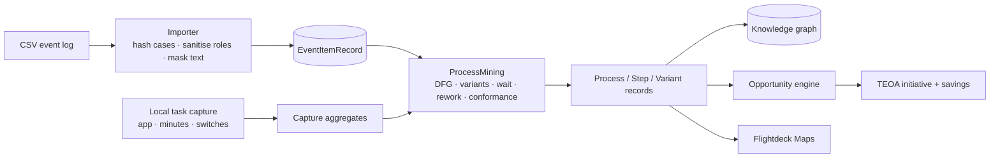

# In-house discovery

ProcessLink owns discovery end to end. It turns a CSV event log or an opt-in
local task capture into a process, variants, cases, a map and an opportunity;
there is no external discovery tenant or connector.

## 1. What is implemented

| Capability | Job | Here |
|---|---|---|---|
| Process mining from event logs | Process discovery | Mapped CSV import with extra attributes and cost → directly-follows graph, cases, variants, filters, cycle/wait, rework, handoffs, weekly throughput |
| Task mining | Desktop activity capture | Opt-in local sampler: frontmost app name, minutes, switches, idle; aggregated per app |
| Variant analysis | Variant explorer | Case sequences, share, average cycle, rework share, variant-level conformance |
| Case explorer | Case drill-down | Every hashed case with its timeline, attributes, cost and deltas |
| Conformance | Conformance checking | Reference sequence coverage **and** place-based token replay with missing/remaining tokens |
| Root cause | Process insights | Attribute values correlated with slow cases or rework, with case counts and impact |
| What-if | Simulation | Automate/remove steps, reduce rework/wait; projected median and assumptions |
| Capacity | Queue simulation | Discrete-event arrivals, FIFO role queues, finite capacity, utilisation |
| Process model | BPMN | Sound block-structured tree from observed variants; BPMN 2.0 export |
| Alignment | Conformance | Optimal alignment against a reference sequence |
| Comparison | Benchmarking | Current filter against the full log: cycle, P90, rework, handoffs |
| Watchlist | Alerts | Rework, wait, variant tail, handoffs and automation signals with severity |
| Bulk import | Connectors | Import every CSV in a folder (scheduled system exports) |
| REST connectors | SaaS connectors | ServiceNow, Salesforce, SAP and generic JSON: configured endpoint, Keychain auth, field mapping, read-only run |
| Export | — | Cases CSV and a `processlink-mining/1` JSON summary |
| Business case / ROI | Opportunity engine | Existing scoring and savings lifecycle, now fed by mined facts |
| Agent/automation handoff | Agent code generation | Existing change-package gate; no autonomous deployment |
| Graph + maps | — | Mined process becomes the same KG nodes, map document and opportunity records |

**Content capture is opt-in.** Window titles, local window screenshots and
keystroke/click **counts** are separate toggles. They never leave this Mac,
titles are PII-masked, screenshot files follow the retention schedule, and
keystrokes are counted rather than recorded. Clipboard, page text/OCR, key
codes and per-person activity remain deliberately unimplemented; those would
need a separate DPIA and works-council decision.

## 2. Data path

### Import and mapping

A CSV is previewed before import. The sheet maps **case id, activity,
timestamp, resource, application** against the real headers; all remaining
columns become filterable attributes (up to 16). A column named `cost` is
parsed as a number.

- `case_id` is SHA-256 hashed; the raw order/ticket id is never stored.
- `resource` is a role. Values that look personal (e-mail, long digits) become
  `role-xxxx`.
- `activity` and every attribute value are masked with the same PII scanner
  used before AI calls.
- Rows with no case, activity or readable timestamp are skipped and counted.
- All rows stay local. The dataset is `internal` by default; a Restricted
  import is refused by the same guard as everything else.
- A cost value is treated as observed cost for that event. If a case-level
  cost is repeated on every row, it will be summed per case; the data-quality
  card shows the observed total so the mistake is visible.

### Mining output

The `ProcessMining` engine in `ProcessLinkKit` produces:

- **cases**: hashed id, ordered events, sequence, start/end, cycle, waiting
  time, rework count, handoffs, resources, attributes, cost;
- **activities**: event count, case count, average wait, rework count,
  handoffs, resources, automation score + reason;
- **edges**: directly-follows count and average wait;
- **variants**: sequence, cases, share, average cycle, rework share;
- **process**: median/P90/mean/max cycle, rework rate, handoff rate,
  start/end activities, total and per-case cost, cases with rework;
- **periods**: up to 12 ISO weeks with cases, median cycle and rework;
- **handovers**: role pair, count and average wait;
- **root causes**: attribute values grouped by slow/rework outcome, with case
  count, average cycle, rework rate and an hours estimate;
- **simulation**: projected median cycle, saved minutes, hours per 1,000 and
  the exact assumptions;
- **conformance**: sequence coverage, exact cases, missing/extra activities,
  plus token replay fitness, missing/remaining/consumed/produced tokens and
  deviating cases.

The workbench presents this in six tabs: **Overview, Process, Cases,
Conformance, Insights, Simulate**. Filters (activity, role, attribute value,
rework-only) apply to the whole view, not just the table. Import supports a
single mapped CSV, the sample log, or a folder of scheduled CSV exports. The process graph is
a deterministic directly-follows map ordered by the dominant variant; it is
not a force simulation and it does not animate.

The same results become `ProcessRecord`, `StepRecord` and `VariantRecord`
with `source = "In-house process mining"`, so Discoveries, Opportunities,
Maps, the KG and Ask work unchanged.

## 3. Local task capture

- Samples the frontmost application every two seconds while the user has
  explicitly started a session.
- Stores **app name, bundle id, minutes, switches, idle minutes** by default.
- App name, minutes, switches and idle are the default.
- Optional: masked window titles, local window screenshots, and input counts.
- Never: key codes, clipboard, page text/OCR, person names.
- One session is a local aggregate; it is not uploaded.
- "Create process" turns the aggregates into a process whose steps are
  applications and whose waste is context switching.
- Requires no macOS permission: `NSWorkspace.frontmostApplication` and
  `CGEventSource` idle time are unprivileged.

## 3a. What "full" does not mean yet

This is a complete **event-log** mining workbench, not an inductive miner or a
capacity simulator:

- discovery offers a directly-follows graph **and** a block-structured
  prefix-tree with paired XOR gateways and BPMN export. It is sound by
  construction, but it is not a full Inductive Miner and does not invent
  unobserved behaviour;
- conformance has sequence coverage, token replay and an **optimal alignment
  against a reference sequence**; it is not an optimal alignment against an
  arbitrary BPMN/Petri net yet;
- the wait arithmetic has no capacity, but a second discrete-event model does
  queue cases through finite role capacity. Its service times start from
  observed waits, not measured touch time, and it has no calendars or breaks;
- there is no OCEL/object-centric mining, streaming ingestion, or incremental
  append to an existing dataset yet;
- connectors are configured REST pulls; background scheduling is not enabled;
- root causes are correlations by attribute, not causal inference;
- the web/Windows workbench now has the full log-mining tabs (import, filters,
  process graph, cases, conformance, insights, simulation); task capture and
  local screenshots remain macOS-only.

## 4. What used to be external

There is no single hard-coded vendor connector. ServiceNow, Salesforce, SAP
and generic JSON APIs are configured as read-only REST pulls with their own
field mapping; credentials live in the Keychain. The toolbar refresh re-reads
local event logs and captures. The trade-off is still breadth: capture is
per-Mac and opt-in, not a fleet-wide screenshot or keystroke service.

## 5. Limits and open questions

- CSV import now has a mapping sheet, but it accepts one sheet per dataset;
  multi-sheet workbooks and XES are not imported yet.
- Conformance has token replay but not optimal alignments; it is explainable,
  not a formal conformance checker.
- The simulator is a wait arithmetic on observed cases; it has no capacity,
  queueing or cost model.
- Task capture observes app switches, not task boundaries. A `task` is inferred
  as a run of events in one app; the user still names the process.
- No cross-person aggregation in this build. Multi-user capture requires the
  group threshold and works-council agreement before it can exist.
- The sample log is synthetic; no customer data is shipped.

## 6. Decision summary

| Question | Answer |
|---|---|
| Can we run discovery without a vendor? | Yes: event logs and opt-in app-level task capture. |
| What is the trade-off? | Breadth: capture is per-Mac and opt-in, not a fleet-wide screenshot/keystroke service. |
| Is it private by construction? | The API choice is the boundary: hashes, roles, app names, masks. No content capture exists to disable. |
| Where does it land? | The KG, maps and opportunity pipeline, with `source` recording the imported log or capture. |
