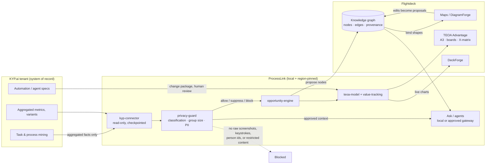

> **Historical note (2026-10-28).** The KYP.ai requirement was withdrawn.
> Discovery is now built in-house; this document is retained as the original
> repository evidence and gap analysis, not as a current dependency. See
> [`IN-HOUSE-DISCOVERY.md`](IN-HOUSE-DISCOVERY.md).

# Phase 0 — Discovery, gap analysis, and open questions

**Status:** complete for the repository, incomplete for the tenant. The KYP.ai,
TEOA and KG inventories below are partly **unknowns by design**: nothing in
this session was allowed to touch a real tenant, and none was available.
Where a fact is not in the repository it is listed as an open question, not
invented.

**Date:** 28 October 2026
**Scope:** `process-contract` (Flightdeck), the TEOA (Advantage) sub-app, the
Knowledge Guardian (KG) sub-app, Flightdeck Maps, and the ProcessLink build.

---

## 1. What the repository actually contains (evidence)

| Area | Where | What it is |
|---|---|---|
| Sub-app registry | `subapps.json` | Three installed apps: `docusign`, `maps`, `advantage`. |
| TEOA sub-app | `flightdeck/server/subapps/advantage/` (14 k LOC), `flightdeck/web/src/subapps/advantage/`, `docs/advantage/` | A configurable lean/six-sigma practice layer: framework versions, focuses, measurements, A3/kaizen cycle, boards, X-matrix, scorecard, meetings, opportunities, benefit observation. |
| TEOA manifest | `flightdeck/server/subapps/advantage/manifest.ts` | id `advantage`, label "TEOA · Operational Advantage", route prefix `/api/apps/advantage`, disabled by default (`SUBAPP_ADVANTAGE_ENABLED`). |
| Framework contract | `flightdeck/server/subapps/advantage/framework.ts` | `advantage-framework/1`: units, maturity levels, objectives, stages, measurables; "names and thresholds are data, arithmetic is code". |
| Opportunities | `flightdeck/server/subapps/advantage/opportunities.ts` | Opportunities are **computed on read**, never stored; `impact = severity × frequency`; rank `impact ÷ effort`; statutory and human-only steps are never automation candidates. |
| Savings / benefit | `flightdeck/server/subapps/advantage/benefitMeasurement.ts` | Read-only observation for the host: baseline and current measurement, framework hash, target. **No estimated → committed → validated lifecycle.** |
| KG (Knowledge Guardian) | `flightdeck/server/subapps/knowledge-guardian/` (~40 test files), `docs` in code | A document-type library and conversion engine: trained mapping specs, immutable type versions, process links to the HR catalogue. **Not a typed process graph.** |
| Retrieval | `flightdeck/server/services/vectorIndex.ts`, `kbIndexer.ts`, `embedder.ts`, `brainCatalog.ts`, `scripts/eval-rag.ts`, `eval-kg.ts` | On-device hybrid search over `kb_docs` / `kb_chunks` / `kb_vectors`, FTS + cosine index, model pin, `VECTOR_SEARCH_ENABLED` gate, RAG evaluation harness. |
| Process catalogue | `shared/processCatalog.ts` | `process-catalog/1`: L1–L4 HR process hierarchy, entity-scoped answers, map links (`MapLinkSchema`), doc links (`DocLinkSchema`). |
| Maps (DiagramForge) | `flightdeck/server/subapps/maps/`, `flightdeck/web/src/subapps/maps/` | `signavio-map/1` canvas (nodes/edges, swimlanes-lite, timing, variables), compiles to `teoa-process/1`. Node data has **no KG id**; KPIs are map-sidecar values. |
| Maps → TEOA bridge | `server/subapps/advantage/mapsRead.ts`, `processKpis.ts`, `opportunities.ts` | Reads sibling sub-app tables; map-derived opportunities; no graph entity. |
| DeckForge | `apps/DeckForge/`, `flightdeck/deckdoc/` | Native macOS deck app (Swift package) plus a deck document format in Flightdeck. |
| KYP.ai | — | **No connector, schema, credential, webhook or documentation exists in the repository.** The only mentions are in check-ins and session logs. |

### 1.1 TEOA today, in its own words

- The framework is admin-defined: units, maturity levels, objectives,
  stages, measurables. The product deliberately does not hard-code 5S, VSM or
  SMED. `docs/advantage/BUILD-PLAN.md` defines 26 build pieces (A1–I1); the
  binding answers are in `docs/advantage/DECISIONS.md` (D1–D5).
- An "A3" is a generic improvement cycle (`Cycle.ts`, `cycle.ts`), not the
  literal seven-box A3. The build plan explicitly refuses to ship a plausible
  looking seven-box A3 that is not TE's.
- Savings are measurements against a target, not a claim lifecycle.
- The sub-app is **project-scoped**, not a security boundary (P2).

### 1.2 The KG today, in its own words

- `knowledge-guardian` = trained document types + conversion + project
  libraries. "A trained document type IS its mapping spec" (`schema.ts`).
- `processLinks.ts` links a document **type** to an L2/L3 catalogue entry.
- The search index is corpus-level (memory, docs, vault, activity), not an
  entity graph. There are no node/edge ACLs, no entity resolution queue, no
  point-in-time query API.
- `server/services/vectorIndex.ts` is a real, gated on-device vector index
  (`VECTOR_SEARCH_ENABLED` default OFF).

### 1.3 Maps today

- `signavio-map/1` nodes: `start|end|step|decision|note|annotation|group|data|system`.
- Node data carries role, system, timing, variables, HR catalogue fields.
- No `kgNodeId`, no KYP metric binding, no provenance, no drift detection.
- Human edits are the source of truth; compilation to `teoa-process/1` is
  deterministic and reports diagnostics.

---

## 2. Integration gap analysis

| Capability the brief asks for | Repository today | Gap | ProcessLink answer |
|---|---|---|---|
| KYP.ai → KG | Nothing | **Total** | `kyp-connector` read-only sync + `kg-client` proposal writer, built here against a sandbox fixture. |
| KYP.ai process facts → Opportunities | Advantage computes from contract feedback and Maps only | **No KYP source** | Opportunity engine adds mined effort, waste type, confidence; keeps the existing `impact ÷ effort` philosophy and statutory guardrail. |
| Live map shapes bound to KG | `signavio-map/1` shapes have labels, roles, timings only | **No binding** | Add `kgNodeId` + provenance to node data; ProcessLink generates maps from steps and binds every shape. |
| Provenance and point-in-time | Measurements carry framework version/hash; maps carry history | **Partial** | Every ProcessLink fact carries source, source id, window, confidence, validity. |
| Entity resolution | None | **Total** | Match KYP applications/processes to registry entities with confidence + human review queue. |
| Savings lifecycle | Target vs measurement | **No estimate → commit → validate** | `value-tracking`: three states, evidence, named validator, one claim per key, conflict detection. |
| TEOA method model | Admin-defined framework; no method catalogue | **No official tool list** | Draft 10-method catalogue, explicitly labelled draft; must be replaced with TE's official definitions (Q4). |
| KG node/edge access control | Project scoping only, explicitly not an access boundary | **No node ACL** | Inherit host permissions; minimum group size enforced before the KG call. |
| GraphRAG with citations | RAG over documents; no graph traversal; no citations to nodes | **Partial** | `kg-client` read models + retrieval contract; local answer engine cites KYP ids and KG nodes. |
| DeckForge reporting | DeckForge app exists; Advantage has no deck export | **Partial** | Review brief export now; deck template contract documented. |
| Mini App / Windows | Flightdeck desktop shell exists; no ProcessLink | **Total** | Web + Windows Tauri form factors in this product; Flightdeck adapter documented. |

### 2.1 The three findings that change the architecture

1. **The KG is not a graph yet.** Building ProcessLink on an assumed property
   graph would be fiction. ProcessLink therefore ships a typed graph *model*
   and a `kg-client` contract, and writes to a local store in this build. The
   ontology migration is a proposal (`docs/KG-ONTOLOGY.md`), not a claim.
2. **TEOA is a configurable practice layer, not a tool list.** ProcessLink must
   not invent official TE definitions. The method catalogue is marked "draft"
   in the UI until Q4 is answered.
3. **Advantage already computes opportunities, but not savings.** ProcessLink
   must not duplicate the pipeline; it extends the source list and adds the
   lifecycle Advantage lacks. The scoring keeps Advantage's shape
   (impact ÷ effort, statutory exclusion).

---

## 3. Data-flow contract

### 3.1 What never moves

- Raw screenshots, video, keystrokes, window titles, clipboard, document
  content, e-mail bodies.
- Person identifiers or per-person aggregates. The connector receives group
  aggregates only; a response containing a person id is dropped and counted.
- Anything classified Restricted, export-controlled or CUI/ITAR.
- Anything below the configured group threshold, at any destination.
- Unmasked personal data, before any hosted model call.

### 3.2 What moves, and where it lands

| Fact | Source | Stored | Consumers |
|---|---|---|---|
| Process, variant, step, role, application, system, site | KYP.ai aggregated export/API | ProcessLink store + KG nodes | Maps, Ask, Opportunities |
| Frequency, cycle time, effort, rework, variance | KYP.ai metrics | Metric nodes + step bindings | Maps overlays, scoring, savings baseline |
| Opportunity + score + route | ProcessLink | Opportunity node | TEOA board, DeckForge |
| Initiative, owner, stage | ProcessLink / TEOA | Initiative node | Advantage, DeckForge |
| Savings claim + evidence | ProcessLink | Savings record node | Leadership roll-up, DeckForge |
| SOP link | Knowledge Guardian | `documented_in` edge | Ask citations, maps |

### 3.3 Idempotency and sync

- One `SyncRun` per attempt with a checkpoint (`cursor`, window, counts).
- Writes are keyed by `(source, source_id, valid_from)`; replay is a no-op.
- A batch is staged, validated, then committed; a failure leaves the
  checkpoint untouched and the batch in the dead-letter store.
- KG writes are proposals with a content hash; the same hash is never applied
  twice.

---

## 4. Privacy, legal and governance checklist

| # | Item | State at build time | Owner |
|---|---|---|---|
| 1 | DPIA for the pilot (DE, PL) | In progress (product copy) | Data Protection Office |
| 2 | DPIA for production | Not started | Data Protection Office |
| 3 | Legal basis per country (DE, PL, PH, MX) | DE/PL in progress; PH/MX not started | Legal |
| 4 | Works council / employee representative consultation (DE) | Blocked on the draft agreement | HR Business Partner |
| 5 | Transparency notice to employees | Done (intranet + capture page) | Internal Communications |
| 6 | Retention schedule | Done: aggregates 400 days, raw stays in KYP.ai | Data Owner |
| 7 | Named data owner | Done: CI Manager (role) | CI Manager |
| 8 | Capture scope confirmation | Done: four sites, no personal devices | KYP.ai Administrator |
| 9 | AI provider and region approval | In progress: local approved, hosted EU-only | Security |
| 10 | Cross-border transfer review | Not started | Legal |
| 11 | Purpose limitation enforcement | **Implemented**: purpose check first in `PrivacyGuard` | Product |
| 12 | Minimum group size | **Implemented**: default 10, enforced before display/export/AI | Product |
| 13 | Classification gate | **Implemented**: Restricted blocked everywhere | Product |
| 14 | PII masking before API | **Implemented**: e-mail, IBAN, employee id, phone, long ids | Product |
| 15 | Immutable audit log | **Implemented locally**: sync, query, AI, approval, export | Product |

**No production use until 1–4 and 9–10 are signed.** The app shows this list
in Governance and refuses nothing silently: every refusal is visible and
audited.

---

## 5. Open questions (must be answered before Phase 1 production work)

| # | Question | Why it blocks | Default used in this build |
|---|---|---|---|
| Q1 | Which KYP.ai modules and licences are active (task mining, process mining, business case, agent code generation, MCP server)? | Determines connector coverage; MCP may replace much of the API work. | Sandbox fixture: processes, variants, steps, metrics, opportunities, agent specs. |
| Q2 | Tenant, region, API base URL, rate limits, export formats, webhook event schemas, retention and anonymisation settings? | The connector cannot be contract-tested without them. | Placeholders; no network calls. |
| Q3 | Which user groups and sites are actually covered by capture? | Group thresholds and works-council scope depend on it. | Four demo sites; all groups ≥ 10 except one 8-person process. |
| Q4 | What is the official TE TEOA tool list, with definitions and savings validation rules? | The method catalogue and validation are currently "draft". | Ten common TEOA-family methods, labelled draft in the UI. |
| Q5 | What is the KG's real ontology and store technology (property graph, RDF, vector), ingestion path and node ACL model? | The ontology proposal must target the real store. | `processlink-kg/1` proposal on the local store. |
| Q6 | Where do savings numbers live today and who owns them (Finance? CI? site)? What blended rate? | Money output needs the owner's rate and sign-off. | €52/h placeholder, one rate, hours as source of truth. |
| Q7 | Which AI models and hosting regions are approved, and is any local model permitted? | Determines provider policy and DPIA. | Local provider default; Claude EU as an option. |
| Q8 | Ownership: process taxonomy, KG ontology, TEOA savings numbers. | Prevents two owners editing one definition. | Named role owners in the UI; no claim of authority. |
| Q9 | Does KYP.ai expose person-level data, and can the API be scoped to aggregates? | If not, the connector needs an aggregation service inside the tenant. | Assume aggregates only; person ids dropped and counted. |
| Q10 | What is the Flightdeck Mini App SDK contract and SSO/role model for this product? | Phase 8 packaging. | Documented adapter, not wired. |

---

## 6. What this build is, and is not

**Is:** a working native macOS app, a web form and a Windows scaffold that
demonstrate the whole chain on clearly labelled sandbox data: discovery →
prioritised opportunity → TEOA initiative → A3 → savings validation → map →
KG → cited answer → governance refusal.

**Is not:** connected to a KYP.ai tenant, approved for production, a
replacement for KYP.ai, an autonomous agent, or a validated savings system.
Every number in the demo is invented; every figure in the UI carries its
source id so the same surface can show real data without redesign.

---

## 7. Next gate

Phase 0 ends here. Phase 1 (monorepo reuse, `process-model`, ontology
migration, privacy guard, read-only connector against a sandbox) is
implemented in this build **as a local prototype**, because the brief asked
for an app in one go. The production gate remains: Q1–Q10 answered, DPIA and
works-council sign-off, and a contract test against the real KYP.ai sandbox.
